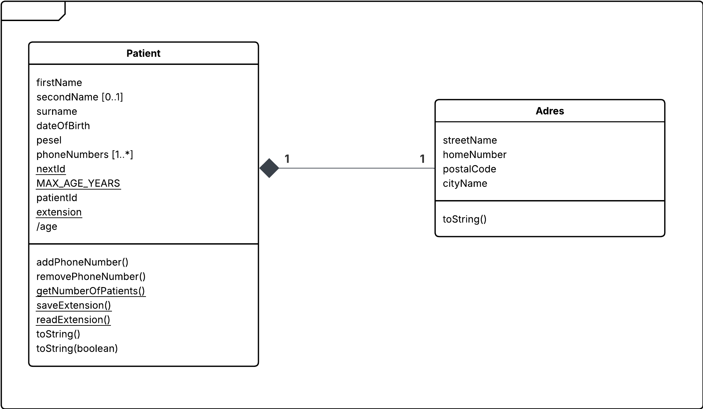
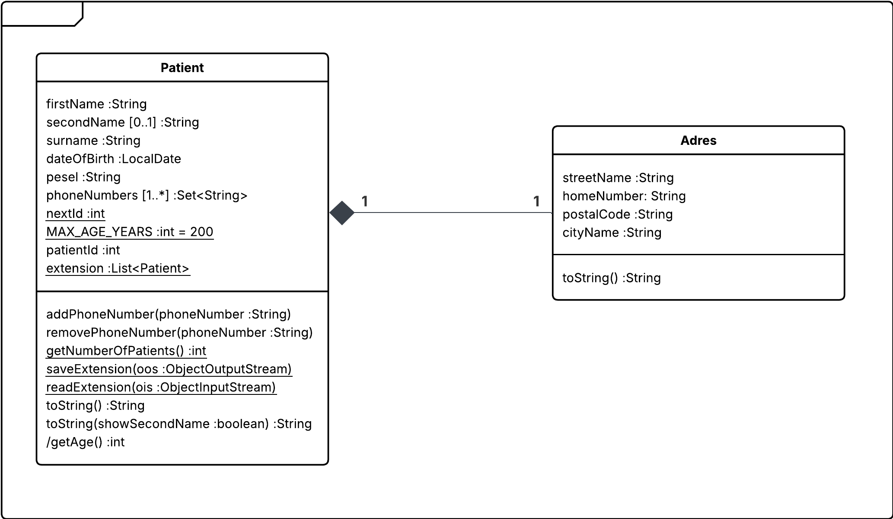

# 01 - Patient Attributes

A small Java domain model centered around a patient and address data.

This module focuses on representing different kinds of object attributes and basic object-oriented modeling concepts.

## Main Concepts

- classes and attributes
- object extent
- persistent extent concept
- complex attributes
- optional attributes
- multivalued attributes
- class attributes
- derived attributes
- class methods
- method overloading / overriding

## Main Classes

```text
Patient.java
Adres.java
Main.java
```

The module also contains a JUnit test:

```text
PatientTest.java
```

## Class Diagrams

### Analytical Class Diagram



### Design Class Diagram



## Tech Stack

- Java 26
- Maven
- JUnit 6

## Running

Open this directory as a Maven project in your IDE and run `Main.java`.

Tests can be executed from the IDE or with Maven when Maven is available on the system.
