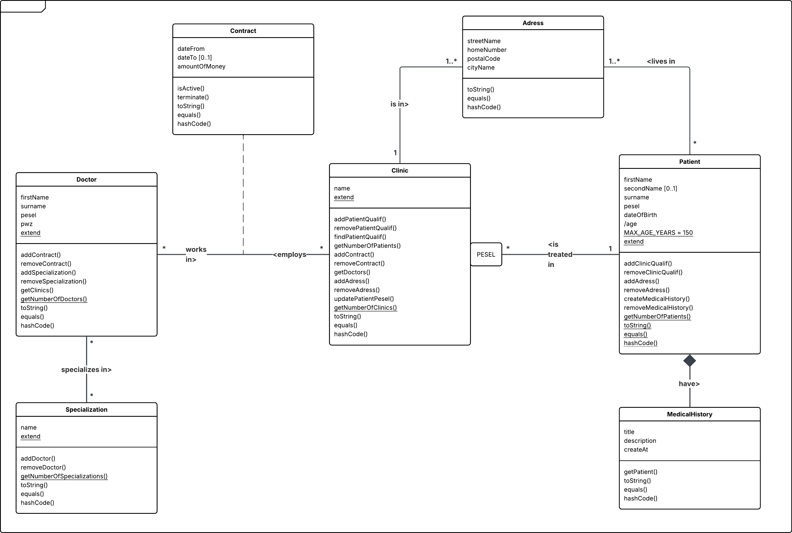
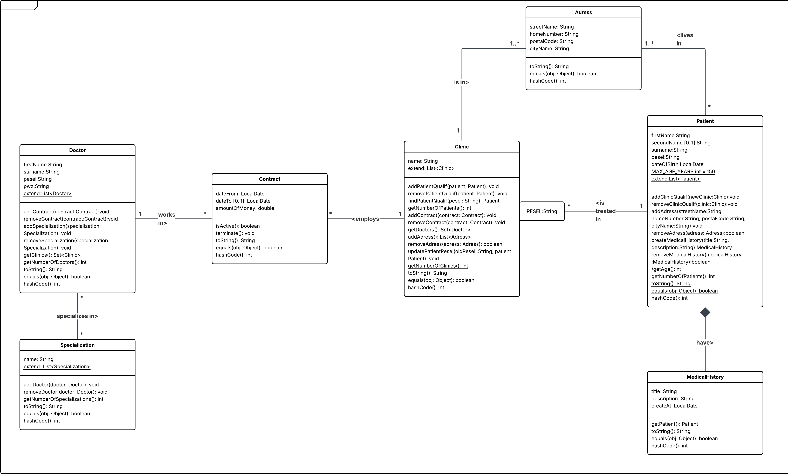

# 02 - Clinic Associations

A Java clinic domain model focused on relationships between objects.

The project models entities such as clinics, doctors, patients, contracts and medical specializations while demonstrating different association patterns.

## Main Concepts

- binary associations
- association with an attribute
- qualified association
- composition
- multiplicity
- bidirectional relationships

## Main Classes

```text
Clinic.java
Doctor.java
Patient.java
Contract.java
Specialization.java
Adress.java
Main.java
```

The project also contains JUnit tests for the main domain classes.

## Class Diagrams

### Analytical Class Diagram



### Design Class Diagram



## Tech Stack

- Java 25
- Maven
- JUnit 6

## Running

Open this directory as a Maven project in your IDE and run `Main.java`.
