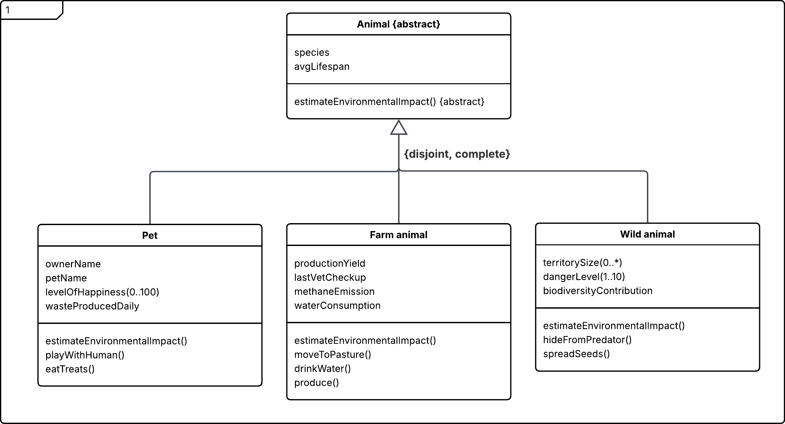
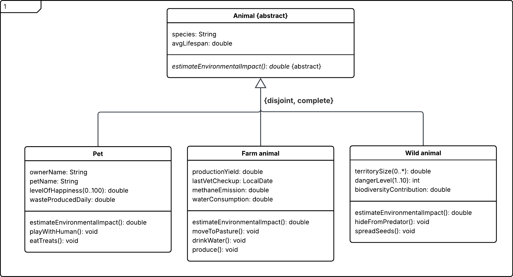
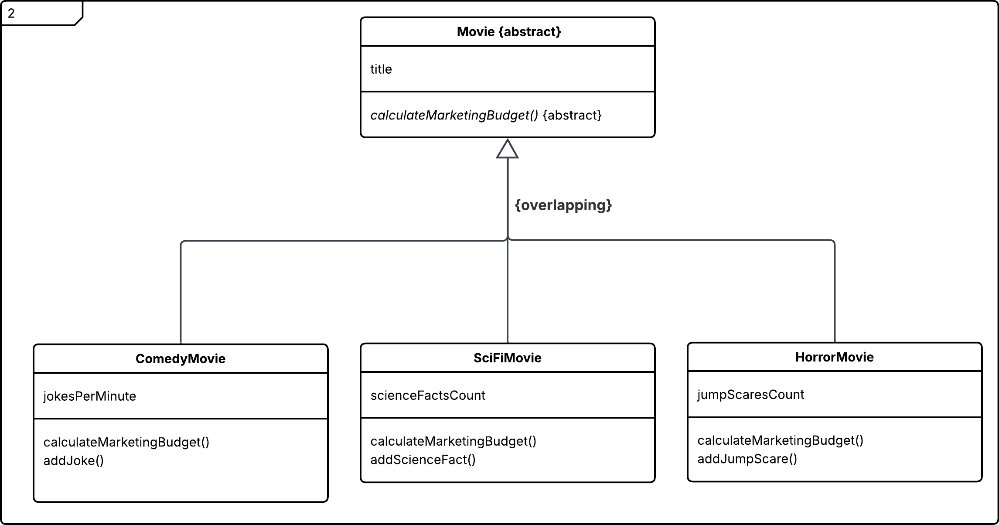
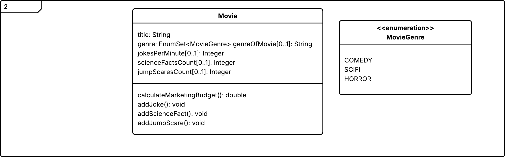
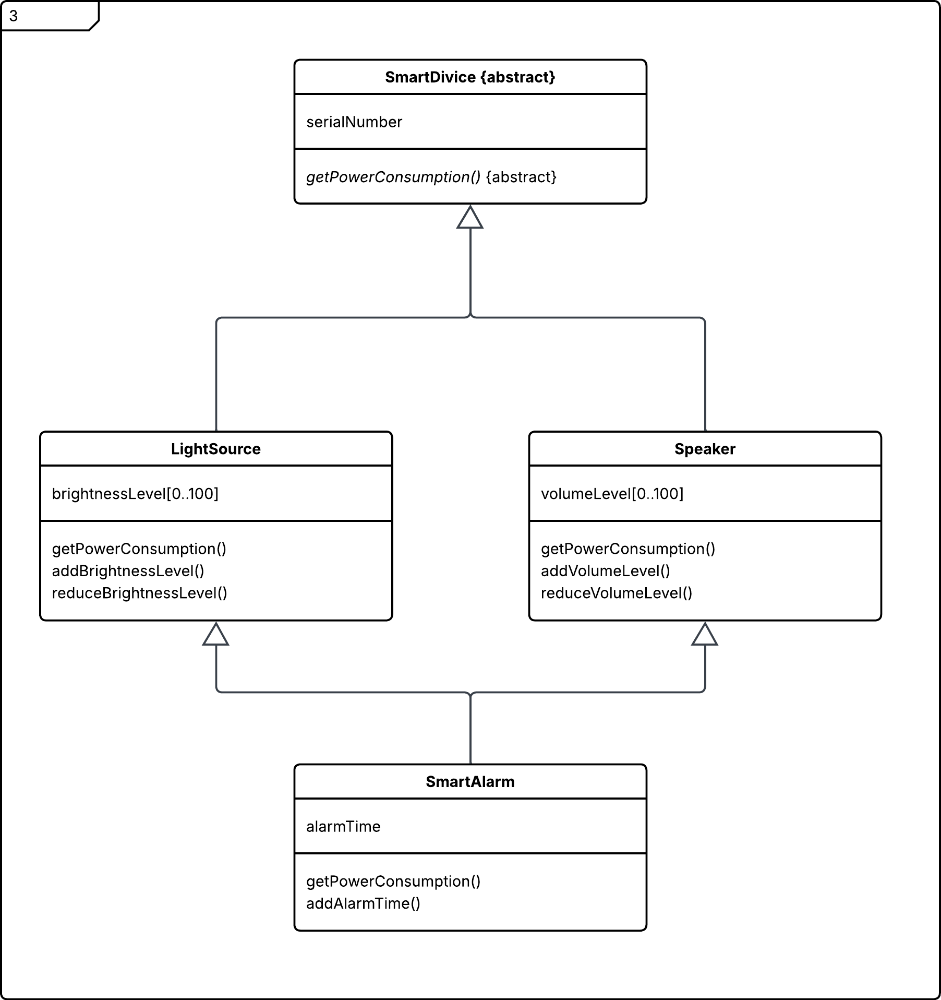
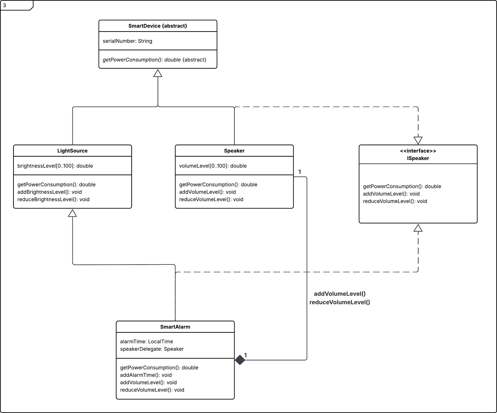
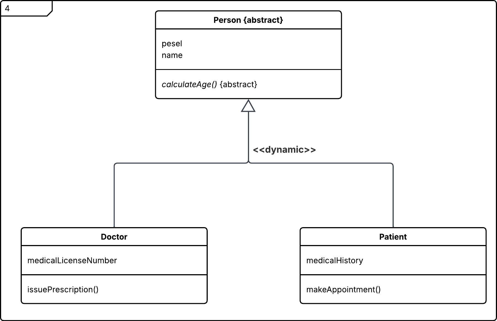
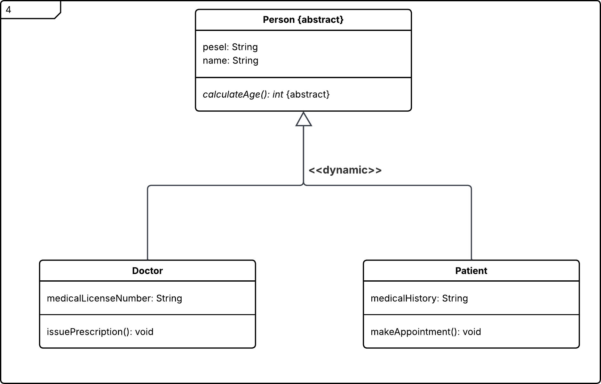
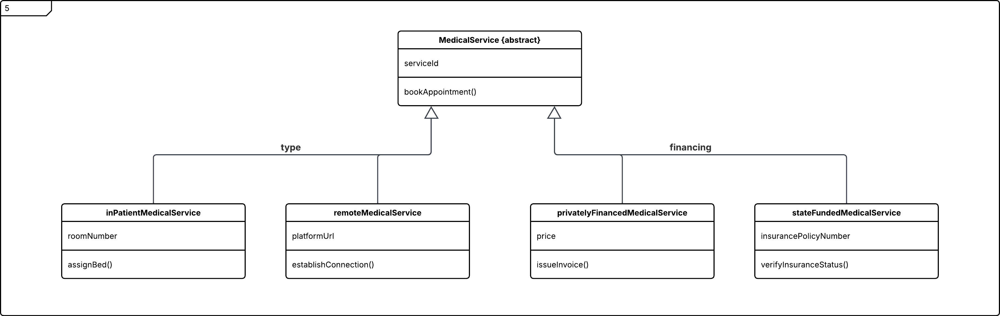
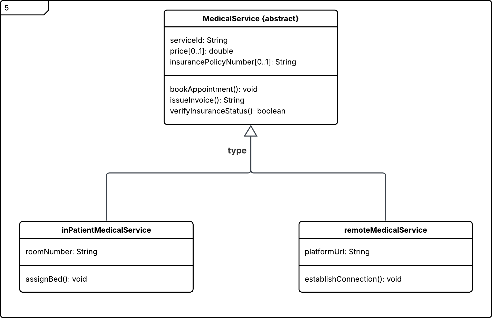

# 03 - Inheritance Patterns

A set of small Java examples demonstrating different inheritance and polymorphism patterns across several domains.

## Covered Patterns

### Abstract Class and Polymorphism

Example domain classes:

```text
Animal
FarmAnimal
Pet
WildAnimal
```

### Overlapping

Example domain:

```text
Movie
MovieGenre
```

### Multiple Inheritance Pattern

Example classes and interface:

```text
SmartDevice
SmartAlarm
Speaker
ISpeaker
LightSource
```

### Multi-Aspect Inheritance

Example medical service model:

```text
MedicalService
InPatientMedicalService
RemoteMedicalService
```

### Dynamic Inheritance

Example medical domain:

```text
Person
Doctor
Patient
```

## Class Diagrams

The module contains five analytical and five implementation class diagrams.

| Analytical | Implementation |
|---|---|
|  |  |
|  |  |
|  |  |
|  |  |
|  |  |

## Tech Stack

- Java 25
- Maven
- JUnit 6

## Running

Each inheritance example contains its own `Main.java` entry point. Open this directory as a Maven project and run the example you want to inspect.
